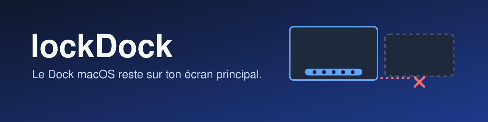

<p align="center"></p>

# lockDock

App de barre de menu macOS qui **empêche le Dock de sauter sur un autre écran** quand le curseur touche le bord d'un écran secondaire.

## Fonctionnalités

- **Verrou** activable/désactivable depuis l'icône de la barre de statut.
- **Dock en bas, à gauche ou à droite** : la position est lue automatiquement dans les réglages du Dock.
- **Choix de l'écran qui garde le Dock** (par défaut : l'écran principal).
- **Marge réglable** : 2, 4, 8, 16 ou 32 px.
- **Maintenir ⌥ (Option)** : le verrou est levé le temps du geste.
- **Lancer au démarrage** (case dans le menu).

Un bord partagé entre deux écrans reste franchissable : seul un bord extérieur d'un écran protégé est bloqué.

## Installation

1. Télécharger `DockLock.zip` dans les [Releases](https://github.com/DamienGdn/lockDock/releases) et l'ouvrir.
2. Déplacer `DockLock.app` dans `/Applications`.
3. L'app est signée « ad hoc » (sans compte développeur) : au premier lancement, clic droit → Ouvrir, ou
   ```bash
   xattr -dr com.apple.quarantine /Applications/DockLock.app
   ```
4. Accorder **Accessibilité** (Réglages Système → Confidentialité et sécurité → Accessibilité), puis relancer.

## Compilation

```bash
./build.sh   # → build/DockLock.app et build/DockLock.zip
```

Nécessite les outils en ligne de commande Xcode (`swiftc`) ; macOS 13 ou plus.

## Fonctionnement

Un `CGEventTap` surveille les mouvements du curseur. Quand il touche le bord « Dock » d'un écran protégé, il est retenu à quelques pixels : le Dock, qui se déclenche au contact du bord, ne voit jamais cet écran.

## Limites

- Le bord concerné des écrans protégés n'est plus pointable au-delà de la marge.
- Une nouvelle compilation change la signature : macOS peut redemander la permission Accessibilité.
